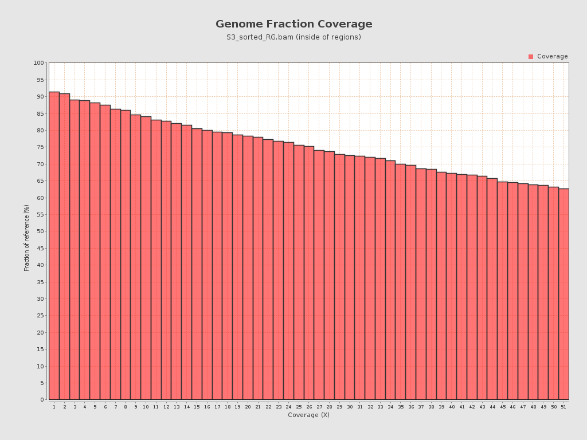
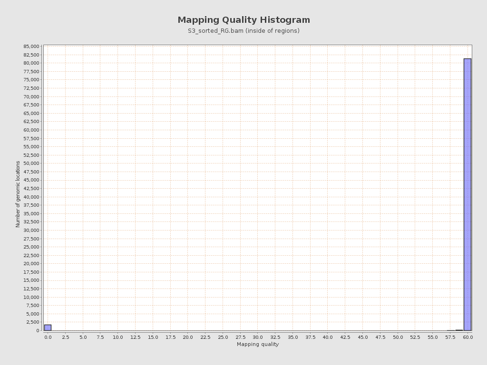
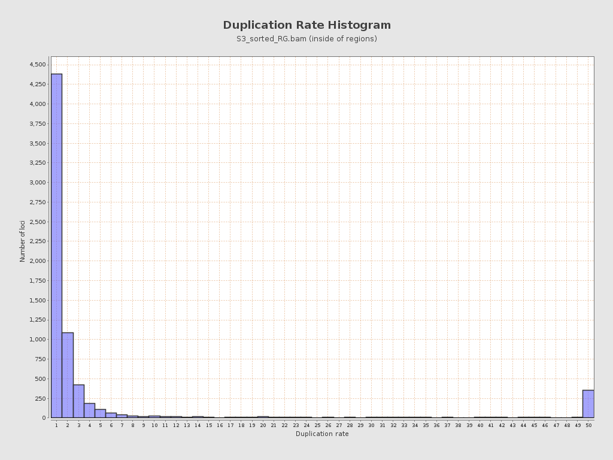
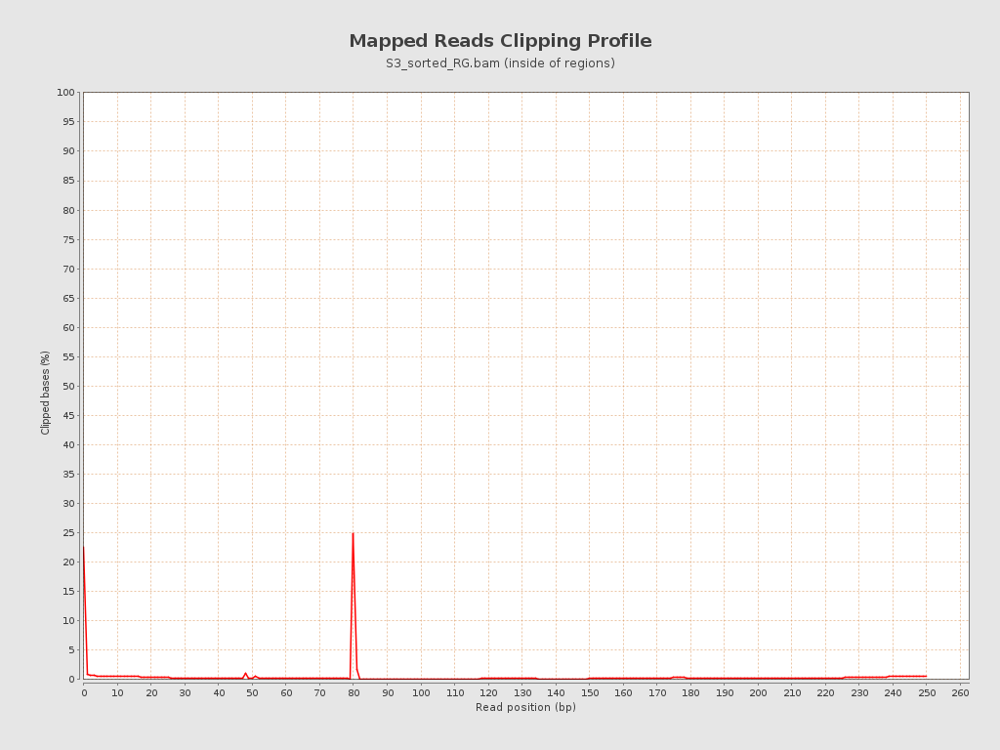

### 1. Informe técnico

El control de calidad del alineamiento de la muestra S3 contra el genoma humano hg19 se realizó con Qualimap 2.2.1 (BAM QC). De las 62.347 lecturas reportadas, 62.323 se mapearon al genoma de referencia y 60.790 se mapearon dentro de las regiones blanco. Estas regiones, definidas por el archivo BED, comprenden 91.120 pb. Los resultados de cobertura que se presentan a continuación corresponden a las regiones blanco y no al genoma completo.

#### 1.1 Cobertura y profundidad de secuenciación

**Figura 1. Fracción de las regiones blanco cubierta a diferentes profundidades de secuenciación.** El eje X representa la profundidad mínima (X) y el eje Y, el porcentaje acumulado de posiciones que alcanza al menos dicha profundidad.

Como se observa en la Figura 1, el 91,44 % de las posiciones evaluadas presentó una cobertura de al menos 1X, el 84,15 % alcanzó 10X, el 72,49 % alcanzó 30X y el 63,11 % alcanzó 50X. La profundidad media fue de 101,28X, con una desviación estándar de 99,57X, lo que evidencia una distribución heterogénea de las lecturas. En particular, 7.799 posiciones (8,56 %) no presentaron cobertura y el 27,51 % no alcanzó 30X, utilizado aquí como umbral descriptivo, no como criterio de validación clínica.

Estas diferencias podrían deberse a diferencias en la eficiencia del enriquecimiento de las regiones blanco, sesgos de amplificación, composición GC o dificultades de alineamiento en determinadas secuencias. La ausencia de cobertura o la profundidad reducida podrían limitar la detección confiable de variantes en dichas regiones, pese a la elevada profundidad promedio.

#### 1.2. Calidad de mapeo

**Figura 2. Distribución de la calidad media de mapeo (MAPQ) por posición genómica cubierta.** El eje X representa la puntuación MAPQ y el eje Y, el número de posiciones genómicas correspondiente a cada categoría.

La Figura 2 muestra un predominio de MAPQ 60, observado en 81.318 de las 83.321 posiciones cubiertas. Además, la calidad media de mapeo reportada fue de 58,74. Estos resultados, junto con el elevado porcentaje de lecturas mapeadas, indican una alta confianza general en la localización de las lecturas respecto del genoma hg19.

No obstante, se observaron 1.745 posiciones en la categoría MAPQ 0. Este hallazgo podría asociarse con alineamientos ambiguos en regiones repetitivas, homólogas o de baja complejidad. Por ello, sería conveniente revisar dichas regiones antes del llamado de variantes. Una buena calidad de mapeo no permite garantizar una cobertura uniforme ni ausencia de errores de secuenciación.

#### 1.3. Duplicación y redundancia de lecturas

**Figura 3. Distribución de la multiplicidad de los sitios de inicio de las lecturas alineadas.** El eje X representa el número de lecturas que comparten un sitio de inicio y el eje Y, la cantidad de sitios correspondiente a cada categoría. 

En la Figura 3 se observa que 4.381 de los 7.080 sitios de inicio contabilizados presentaron una única lectura, mientras que los 2.699 restantes presentaron más de una. También se observa una acumulación en la última categoría del histograma con 355 sitios, lo que indica una elevada multiplicidad local. Adicionalmente, Qualimap estimó 53.710 lecturas duplicadas (88,35 % de las 60.790 lecturas mapeadas dentro de las regiones blanco). Este porcentaje corresponde a lecturas estimadas como duplicadas y no es equivalente al porcentaje de sitios con múltiples lecturas.

Esto podría relacionarse con la amplificación por PCR, una reducida complejidad de la biblioteca o el diseño del enriquecimiento dirigido. Sin embargo, compartir una posición de inicio no demuestra por sí solo que las lecturas sean duplicados de PCR. Como el protocolo no incluyó un marcado específico de duplicados ni los excluyó del control de calidad, la profundidad observada podría sobreestimar el número de fragmentos independientes. Se recomienda caracterizar la duplicación de acuerdo con el tipo de biblioteca antes de interpretar variantes.

#### 1.4. Perfil de clipping de las lecturas mapeadas

**Figura 4. Distribución porcentual de las bases con clipping según su posición en las lecturas mapeadas.** El eje X representa la posición en pares de bases y el eje Y, la proporción de bases recortadas dentro del perfil normalizado de Qualimap, que contempla soft-clipping y hard-clipping.

La Figura 4 presenta dos picos principales en las posiciones 0 y 80 pb, que concentran el 22,56 % y el 24,89 % del perfil de clipping, respectivamente. En el resto de las posiciones, los valores son considerablemente menores. Pese a estos picos, el reporte identificó 526 lecturas con clipping (0,84 % del total de lecturas). Por lo tanto, los porcentajes del perfil no representan la proporción de todas las lecturas afectadas en cada posición.

El patrón podría relacionarse con adaptadores residuales, bases de baja calidad, diferencias entre la muestra y la referencia o dificultades de alineamiento. El pico localizado en la posición 80 podría estar asociado a una subpoblación de lecturas con características compartidas, hipótesis que requeriría examinar los códigos CIGAR y las longitudes de lectura. El resultado complementa la identificación previa de la lectura con CIGAR `2S100M`, aunque una sola lectura no permite explicar el patrón global.

### 2. Conclusiones

La muestra S3 presentó un elevado porcentaje de lecturas mapeadas de 99,96 % y una calidad media de mapeo favorable de 58,74, lo que indica que el alineamiento contra hg19 fue globalmente satisfactorio.

Sin embargo, la elevada profundidad media 101,28X no se tradujo en una cobertura uniforme de las regiones blanco, dado que el 8,56 % de sus posiciones no presentó cobertura y el 27,51 % no alcanzó 30X. Asimismo, se identificó una redundancia relevante en los sitios de inicio de las lecturas y una baja proporción global de lecturas con clipping de 0,84 %, con un patrón de concentración en posiciones específicas.

En conjunto, el alineamiento constituye una base favorable para continuar el análisis bioinformático, pero se recomienda revisar las regiones con cobertura insuficiente o MAPQ reducido y evaluar la duplicación de lecturas antes del llamado de variantes. Los resultados no permiten confirmar las causas de los patrones detectados ni establecer por sí solos la aptitud clínica de la muestra.

# Anexo
---

[Reporte completo de Qualimap](Reporte_qualimap/qualimapReport.html)